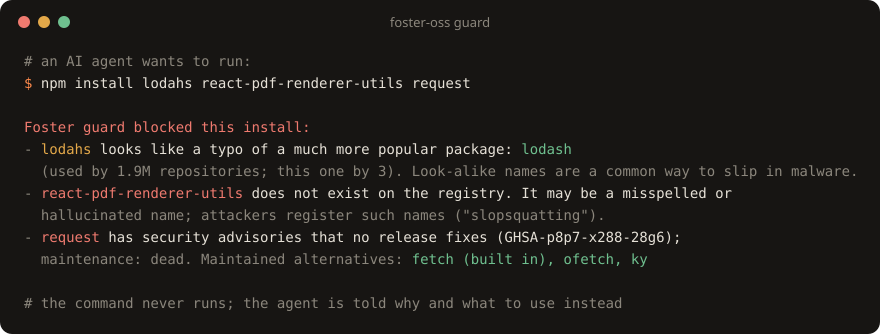
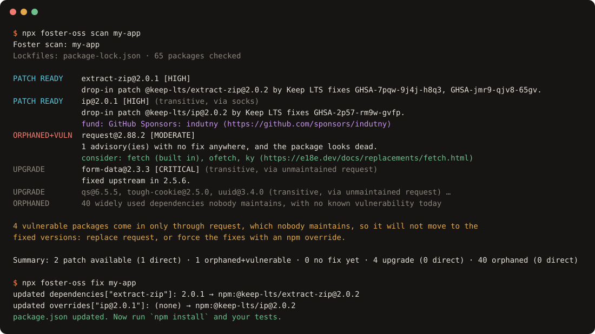

<p align="center"></p>

<h1 align="center">Foster</h1>

<p align="center">
  <a href="https://www.npmjs.com/package/foster-oss"></a>
  <a href="https://github.com/foster-oss/foster/actions/workflows/ci.yml"></a>
  <a href="https://foster-oss.github.io/foster/"></a>
  <a href="LICENSE"></a>
</p>

**Stop AI agents, and people, from installing malware, hallucinated names and packages nobody can fix.
Then find the dependencies nobody maintains anymore, and the fixes that exist for them.**

Foster checks every package a command would install *before* it runs, and scans the dependencies you
already have. Open source, no account or API key, six ecosystems: npm, PyPI, Cargo, Go, RubyGems and
Packagist.

```bash
npx foster-oss guard -- npm install some-package   # check an install before it runs
npx foster-oss scan                                # what in my lockfile is orphaned, or vulnerable with no fix?
npx foster-oss fund                                # which at-risk dependencies I rely on, and who to sponsor
npx foster-oss fix                                 # switch to published drop-in patches (edits package.json)
```

<p align="center"></p>
<p align="center"><sub>Real output. <code>lodahs</code> was picked as a made-up typo of lodash for this demo; it turned out to be reported malware.</sub></p>

**The Orphan Index**, a public dataset of which critical packages are unmaintained, is live at
**<https://foster-oss.github.io/foster/>** and rebuilt every week.

## Guard: check installs before they run

Coding agents run `npm install` and `pip install` on their own. The package they pick can be a
hallucinated name (attackers register those: "slopsquatting"), a look-alike of a popular package,
known malware, or abandoned with holes nobody will fix. `foster-oss guard` decides before anything runs:

| Situation | Decision |
|---|---|
| The package or version is known malware (OSV, including the OpenSSF malicious-packages database) | **deny** |
| The name does not exist on the registry (checked against the real registry, not just an index) | **deny**, with "did you mean …?" |
| A vulnerability that no release fixes | **deny**, with maintained alternatives |
| A look-alike of a far more popular package (`expres` → `express`, `reqeusts` → `requests`) | **ask** |
| npm: a package first published in the last 30 days that runs an install script | **ask**, showing the script |
| npm: a fresh release that adds an install script the previous release did not have (how the 2025 Shai-Hulud worm spread) | **ask**, suggesting the previous version |
| Brand-new package that no index tracks yet | **ask** |
| Installed straight from a URL or git (`https://…/x.tgz`, `github:a/b`, `git+https://…`) | **ask**, since no database covers it |
| A vulnerable version that a newer release fixes, or a drop-in patch exists | **ask** |
| Dead or dormant, with no known vulnerability | allowed, with a **note** and maintained alternatives |
| Everything else | allowed silently |

Install scripts are questions, not blocks: native modules run them too. A typical check takes one to two
seconds, and guard **fails open**: if the registry or OSV can't be reached, the install goes ahead.

### What guard reads

The names on the command line are only part of what an install puts on disk. Guard understands npm, pnpm,
yarn, bun, pip, uv, poetry, pipx, pipenv, cargo, go, gem, bundle and composer, including `cd app && npm i -D x`
chains and options before the subcommand (`npm --prefix app ci`), and follows the less obvious ways in:

- **Lockfile installs**: `npm ci`, `pnpm install`, `yarn`, `pip install -r`, `uv sync`, `poetry install`,
  `bundle install`, `composer install`, `cargo fetch`. Every locked package is checked for known malware in
  one OSV request; locked names that look like popular packages are looked up too (missing from the
  registry: deny; a little-used look-alike: ask).
- **No lockfile yet** (a fresh clone, `bun.lockb`): the packages in `package.json`, including dev, optional
  and peer dependencies (npm 7+ installs peers; optional ones are skipped), across every workspace of a
  monorepo (`workspaces`, `pnpm-workspace.yaml`).
- **Stale lockfiles** after a merge: a plain `npm install` (or `pnpm install`, `yarn`, `bun install`, and
  `npm install <name>`, which installs the rest of the project too) rewrites the lockfile from package.json,
  so whatever the lockfile does not have yet, or has at another version, is checked. `npm ci`,
  `--frozen-lockfile` and `--immutable` install the lockfile as it is.
- **Overrides**: npm `overrides`, yarn `resolutions` and `pnpm.overrides` replace what a dependency installs
  (`"ms": "npm:crossenv@0.0.2-security"` installs crossenv under the name ms). The replacement is checked.
- **Aliases** (`tc@npm:@ctrl/tinycolor@4.1.1`) and **registry tarball URLs**: the real package and version.
- **Ranges and dist-tags** (`x@^4.1.0`, `x@next`): the version npm would pick, not just the latest.
- **Run-once tools**: `npx`, `npm exec`, `pnpm dlx`, `pnpx`, `yarn dlx`, `bunx`, and `corepack pnpm …` /
  `corepack yarn@4 …`.

A fixable vulnerability in a dependency your own package.json already pins is a note rather than a
question on every install (`scan` reports it). More than five notes are summarised.

### Set it up

**Claude Code**: a PreToolUse hook in `.claude/settings.json` (project) or `~/.claude/settings.json` (all projects):

```json
{
  "hooks": {
    "PreToolUse": [
      {
        "matcher": "Bash",
        "hooks": [{ "type": "command", "command": "npx -y foster-oss guard --hook claude", "timeout": 60 }]
      }
    ]
  }
}
```

The hook answers with Claude Code's `deny` / `ask` permission decisions, uses the session's working
directory for lockfiles, and stays silent for commands that install nothing.

**Other agents (Codex, Cursor, Gemini CLI, Copilot, …)**: add the [MCP server](#mcp-server) and this rule to
your `AGENTS.md` (or `.cursorrules`, `GEMINI.md`, `.github/copilot-instructions.md`):

```markdown
Before running any command that installs packages, call the `foster_check_install_command` tool
(or run `npx -y foster-oss guard -- <the exact command>`). If it says DENY, do not run the command:
explain why and suggest the alternative it names. If it says ASK, show the reason and let the user decide.
```

**Your own shell**: wrap npm, npx, pnpm, pnpx, yarn, bun, corepack, pip, uv, poetry, pipx, pipenv, cargo,
go, gem, bundle and composer, so every install you type is checked first. A deny cancels it, an ask prompts
`Install anyway? [y/N]` (and cancels when nobody can answer), and if guard itself cannot run the install goes
ahead. Install Foster once so the check starts fast:

```sh
npm i -g foster-oss
# then in ~/.bashrc or ~/.zshrc
eval "$(foster-oss shell-init bash)"     # or: zsh
```

```powershell
# $PROFILE
foster-oss shell-init powershell | Out-String | Invoke-Expression
```

To skip the check once: `command npm install …` (bash/zsh).

**Scripts and CI**: `foster-oss guard -- <command>` exits **0** (allow), **1** (deny) or **10** (ask), so
`foster-oss guard -- npm ci && npm ci` stops on both. `--strict` turns ask into 1, `--quiet` prints nothing
on allow, `--json` returns every verdict.

### How guard is tested

Before release, an AI agent red-teamed guard for seven rounds with one goal: get known malware onto disk
without guard noticing. It found 15 bypasses (`npm ci`, aliases, overrides, corepack, stale lockfiles, peer
dependencies, …) and one regression; each is now a unit test. Because unit tests stub the network, a
[CI job](.github/workflows/ci.yml) also replays real malware (`crossenv`, `@ctrl/tinycolor@4.1.1`,
`ua-parser-js@0.7.29`, a malicious override, a workspace and a peer dependency) against the live npm
registry and OSV on every change. Found another way past it?
[Report it](SECURITY.md).

## Why: the data

We classified the **5,797 most depended-on packages** across six ecosystems (the
[ecosyste.ms](https://ecosyste.ms) critical set) in November 2026:

| Ecosystem | Critical packages | Dead | Dormant | Unmaintained |
|---|---:|---:|---:|---:|
| npm | 2,295 | 195 | 514 | **31%** |
| RubyGems | 974 | 78 | 169 | **25%** |
| Cargo (Rust) | 813 | 70 | 116 | **23%** |
| Go | 645 | 120 | 168 | **45%** |
| Packagist (PHP) | 548 | 59 | 56 | **21%** |
| PyPI | 522 | 34 | 49 | **16%** |
| **All** | **5,797** | **556** | **1,072** | **28%** |

- The unmaintained npm and PyPI packages alone are downloaded **~192 billion times a month**;
  all unmaintained packages together back **~940 million** dependent repositories.
- **828** unmaintained packages can only be published by a single account.
- **10 unmaintained packages have security advisories that no upstream release fixes**, for example:

| Package | Advisory with no upstream fix | Drop-in patch |
|---|---|---|
| npm `extract-zip` (113M downloads/month) | 2 × HIGH: symlink path traversal / arbitrary file write | [`@keep-lts/extract-zip`](https://keep-lts.com) |
| npm `ip` (38M downloads/month) | HIGH: SSRF, `isPublic()` misclassifies `127.1`, `::fFFf:127.0.0.1`, … | [`@keep-lts/ip`](https://keep-lts.com) |
| Go `github.com/dgrijalva/jwt-go` (99K dependent repos) | HIGH: audience check bypass | none: move to `github.com/golang-jwt/jwt/v5` |
| Cargo `failure` | 2 × CRITICAL | none: deprecated, use `anyhow` / `thiserror` |
| Packagist `phpoffice/phpexcel` | 20 advisories, 10 HIGH | none: move to `phpoffice/phpspreadsheet` |
| npm `elliptic` (74M downloads/month) | LOW: risky cryptographic primitive | none yet |

The full list is in the [Orphan Index](https://foster-oss.github.io/foster/).

Upgrade bots (Dependabot, Renovate) can't help when no fixed version exists, and `npm audit`
just says "no fix available". Meanwhile, people *are* fixing abandoned packages: maintained forks,
community patches and services like [Keep LTS](https://keep-lts.com) publish drop-in releases. But
nothing connects "this dependency of yours is orphaned and vulnerable" to "here is the fix someone
already published". **Foster is that connection: an open, vendor-neutral index and scanner.**

## What to do about an orphaned dependency, in order

1. **Upstream first.** If anyone still answers, send the fix or report to the original project.
2. **Fund the maintainers.** Orphaned packages are a funding problem before they are a security problem.
   `npx foster-oss fund` lists the at-risk dependencies you rely on and who to sponsor (most of them come down
   to a handful of people), or, when nobody takes sponsorship, where to offer help or co-maintenance.
3. **Move to a maintained alternative** when one exists (`consider:` in the scan output).
4. **Use a drop-in patch** only as a stopgap while you do one of the above (`npx foster-oss fix`).

## Scan, fund and fix

<p align="center"></p>
<p align="center"><sub>Real output from scanning a small app that depends on <code>socks</code>, <code>request</code> and <code>extract-zip</code> (trimmed).</sub></p>

```
Orphan Index ─────► foster-oss scan ─────► patch registry ─────► foster-oss fix
(weekly, public:     (your lockfile +        (drop-in patches      (npm alias override,
 who is dead,         OSV, live)              from any provider:    imports unchanged)
 dormant, unfixed)                            Keep LTS, Foster, …)
```

1. **Orphan Index.** Every week, Foster classifies the critical package set as active / dormant /
   dead from public signals and lists advisories that no release fixes ([methodology](METHODOLOGY.md)).
2. **Scan.** `foster-oss scan` reads your lockfile, checks every package against OSV, and tells
   apart *malware*, *upgrade*, *no fix yet*, *orphaned and vulnerable*, and *a drop-in patch exists*.
3. **Patch registry.** [`registry/patches.json`](registry/patches.json) lists published drop-in
   patches for abandoned packages, whoever publishes them, with the versions they replace and the
   advisories they fix. Today: 12 packages from Keep LTS. Anyone can add an entry by PR.
4. **Fix.** `foster-oss fix` points your project at the patch through an npm alias
   (`"ip": "npm:@keep-lts/ip@2.0.2"`), so `require("ip")` keeps working.
5. **Patch Lab, as a last resort.** When an orphaned, vulnerable package has no patch anywhere,
   Foster can build one in the open under the rules in [GOVERNANCE.md](GOVERNANCE.md). Foster
   does not duplicate patches that already exist.

### CLI

Node 20+. Reads lockfiles from six ecosystems:

| Ecosystem | Files |
|---|---|
| npm | `package-lock.json`, `npm-shrinkwrap.json`, `pnpm-lock.yaml`, `yarn.lock` (classic and berry) |
| PyPI | `uv.lock`, `poetry.lock`, `Pipfile.lock`, pinned `requirements.txt` |
| Cargo | `Cargo.lock` |
| Go | `go.mod` (including `replace` directives) |
| RubyGems | `Gemfile.lock` |
| Packagist | `composer.lock` |

| Command | What it does |
|---|---|
| `foster-oss guard -- <command>` | Check the packages a shell command would install, before it runs. `--hook claude` for Claude Code, `--strict`, `--quiet`, `--json` |
| `foster-oss shell-init <shell>` | Shell functions that guard the installs you type (bash, zsh, powershell) |
| `foster-oss scan [dir]` | Report malware, orphaned and unpatched dependencies. `--since <ref>` (only what changed), `--recursive` (monorepos), `--json`, `--markdown`, `--sarif <file>`, `--all`, `--fail-on <level>`, `--offline` |
| `foster-oss scan --sbom <file>` | Same, from a CycloneDX or SPDX JSON SBOM (any tool that emits one) |
| `foster-oss fund [dir]` | At-risk dependencies you rely on, ranked, with their maintainers' sponsorship links (GitHub Sponsors, Open Collective, Tidelift, …), the few people who cover most of them, and where to help when there is no link |
| `foster-oss fix [dir]` | Point dependencies at published drop-in patches. `--dry-run`, `--force` |
| `foster-oss check <name[@version]>` | Maintenance status, reach, unfixed advisories, patches and replacements for one package. `--ecosystem pypi\|cargo\|go\|rubygems\|packagist` |
| `foster-oss mcp` | Start the MCP server for AI agents |

What the findings mean:

| Finding | Meaning |
|---|---|
| `MALWARE` | This exact version is a known malicious package or hijacked release ([OSV](https://osv.dev), OpenSSF malicious-packages). Remove it and rotate credentials. Fails the scan by default. |
| `PATCH READY` | A published drop-in patch exists for this exact version. Run `foster-oss fix`. |
| `ORPHANED+VULN` | Known vulnerability, no fix anywhere, package dead or dormant. Prefer an alternative, or [nominate it](https://github.com/foster-oss/foster/issues/new?template=adopt.yml). |
| `NO FIX YET` | Known vulnerability with no release yet, but the package looks maintained. |
| `UPGRADE` | Fixed upstream. Just upgrade. |
| `ORPHANED` | Widely used and unmaintained, no known vulnerability. Shown with `--all`. |

**Direct or transitive, and through what.** Foster reads the dependency graph from the lockfile (npm,
pnpm, yarn, uv, Poetry, Cargo, Bundler, Composer, and CycloneDX/SPDX SBOMs that record it), so every
transitive finding names the direct dependency that brings it in, the one you can actually upgrade or
replace:

```
UPGRADE        form-data@2.3.3 [CRITICAL] (transitive, via unmaintained request)
               fixed upstream in 2.5.6.
UPGRADE        body-parser@1.20.1 [HIGH] (transitive, via express)
               fixed upstream in 1.20.9. Upgrade normally; no patch needed.
…
ORPHANED       49 widely used dependencies nobody maintains, with no known vulnerability today
               49 come in through other packages, mostly via request (34), express (17)

4 vulnerable packages come in only through request, which nobody maintains, so it will not move to the
fixed versions: replace request, or force the fixes with an npm override.

Summary: 1 patch available · 1 orphaned+vulnerable · 0 no fix yet · 11 upgrade (1 direct) · 49 orphaned (0 direct)
```

(A project depending on `request`, `express@4.18.2` and `ip@2.0.1`.) A direct dependency that nobody
maintains will never move to a fixed version of what it pulls in, so Foster says so instead of "just upgrade".

`--json` carries the same: `dependency.direct`, `dependency.via` and a `summary` with direct counts per kind.

Findings also name **maintained replacements** (`consider: fetch (built in), ofetch, ky`): for npm from
the e18e community's [module-replacements](https://github.com/e18e/module-replacements) dataset, and for
every ecosystem from Foster's reviewed list in [`registry/alternatives.json`](registry/alternatives.json)
(e.g. `jwt-go` → `golang-jwt/jwt/v5`, `failure` → `anyhow`/`thiserror`, `phpexcel` → `phpspreadsheet`).

`fix` is npm-ecosystem only for now (npm, pnpm, yarn). Other ecosystems get findings only.

A patch from a third-party provider is that provider's code and responsibility. Foster lists it so
you can find it; read the provider's source and advisory before adopting it.

### GitHub Action

```yaml
- uses: foster-oss/foster@v0
  with:
    fail-on: orphaned-vulnerable   # none | malicious | patch-available | orphaned-vulnerable | unpatched | any
    comment: true                  # optional PR comment; needs pull-requests: write
    sarif: true                    # optional: findings in the Security tab; needs security-events: write
```

On pull requests the Action checks **only the dependencies the PR adds or changes** (`only-new: true`,
compared with the base branch), so existing debt doesn't drown out what the PR introduces. On pushes and
schedules it checks everything. Locally: `npx foster-oss scan --since main`. Known malware fails the job at
every level except `none`.

The report is also written to the job summary. With `sarif: true`, findings appear in GitHub code
scanning next to your other security alerts.

### MCP server

Listed in the official [MCP Registry](https://registry.modelcontextprotocol.io) as `io.github.foster-oss/foster`,
or configure it directly (Claude Code, Codex, Cursor, …):

```json
{ "mcpServers": { "foster": { "command": "npx", "args": ["-y", "foster-oss", "mcp"] } } }
```

Tools: `foster_check_install_command` (call it before running an install command), `foster_check_package`
(call it before adding a dependency; it also catches names that don't exist, a common sign of a hallucinated
package), `foster_scan_project`, `foster_fund_project`, `foster_list_patches`.

**Skill**: copy [`skills/foster`](skills/foster/SKILL.md) into your agent's skills folder
(e.g. `.claude/skills/foster/`).

### Library

```ts
import { scanProject, checkPackage } from "foster-oss";
const result = await scanProject("./my-app");
```

## Adding a replacement suggestion

Know the maintained successor of an abandoned package? Add it to
[`registry/alternatives.json`](registry/alternatives.json) by pull request. Only official successors,
or replacements the original project itself recommends, with a link to the migration guide.

## Adding a patch to the registry

If you publish (or know of) a drop-in security release of an abandoned package, open a PR adding
it to [`registry/patches.json`](registry/patches.json): the original package and affected versions,
the replacement package and version, the advisories it fixes, and who maintains it. Requirements:
public source, the original license kept, and a regression test for each advisory.

## Contributing

New here? Pick a [good first issue](https://github.com/foster-oss/foster/labels/good%20first%20issue)
or something marked [help wanted](https://github.com/foster-oss/foster/labels/help%20wanted): Maven and
NuGet support, translations of the site, replacement suggestions, an ignore file, and more. Start with
[CONTRIBUTING.md](CONTRIBUTING.md).

Foster's rules are in [GOVERNANCE.md](GOVERNANCE.md), its stance on AI-written code in
[AI_POLICY.md](AI_POLICY.md), and how to report a problem in Foster itself, including a way past guard, in
[SECURITY.md](SECURITY.md).

## Data and credits

Maintenance and reach data: [ecosyste.ms](https://ecosyste.ms) (CC BY-SA 4.0). Vulnerabilities and malware:
[OSV.dev](https://osv.dev), the [OpenSSF malicious-packages](https://github.com/ossf/malicious-packages)
database and the GitHub Advisory Database. Drop-in patches currently listed:
[Keep LTS](https://keep-lts.com). The dead/dormant buckets follow Andrew Nesbitt's
[“Weekend at Bernie's”](https://nesbitt.io/2026/05/08/weekend-at-bernies) analysis.

Replacement suggestions: [e18e module-replacements](https://github.com/e18e/module-replacements) (MIT).

Code: [Apache-2.0](LICENSE).
